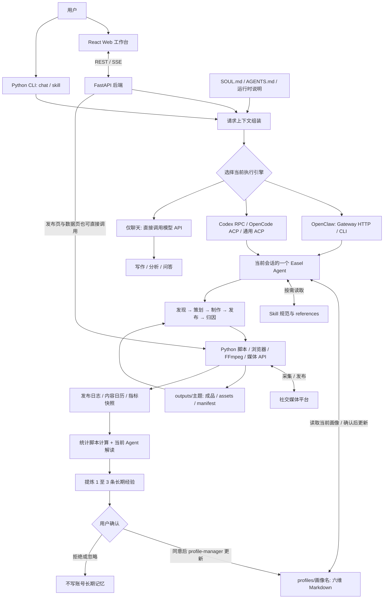
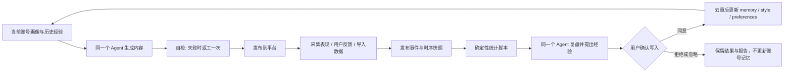

# Easel 源码架构、记忆与自我进化分析

分析日期：2026-11-06（Asia/Shanghai）。

- 上游仓库：https://github.com/ZJU-REAL/Easel
- 本地检出目录：`Easel/`（独立上游仓库，不纳入本项目源码）
- 分支：`main`
- 分析提交：`5c12e42e9019d276368130b52385b770749ffa6f`
- 提交时间：2026-11-02 16:18:50 +08:00
- 方法：克隆后静态阅读入口、适配器、Agent 规则、画像实现、发布回流、统计脚本与相关测试。没有运行安装器、接入模型或登录社媒；以下机制判断不代表端到端效果已经验证。

## 1. 核心结论

Easel 的业务架构是 **单 Agent + 多 Skill + 可替换的执行引擎 + 文件化状态**。一个会话里的当前 Agent 负责发现、策划、制作、发布、归因，按任务选择必要阶段。

它支持多个会话、多个账号画像、多个执行引擎，以及调用多个媒体模型；这些能力本身不构成多 Agent 协作。在检查的 Easel 业务路径中，没有看到研究员、规划员、执行员、评审员等多个独立 Agent 的分配、通信、结果汇合与协商机制。

“自我进化”主要体现为 **运营经验在上下文中的积累与复用**：真实表现或用户反馈 → 统计与复盘 → 提炼经验 → 用户确认 → 更新画像 → 下次创作读取。未看到在该链路里训练模型权重、自动进化 Agent 拓扑或自动修改 Skill 的实现。

证据：

- [AGENTS.md 第 3 行明确一个 Agent 执行五层](https://github.com/ZJU-REAL/Easel/blob/5c12e42e9019d276368130b52385b770749ffa6f/agents/workspace/AGENTS.md#L3)。
- [适配器注册与按 runtime 取一个 adapter](https://github.com/ZJU-REAL/Easel/blob/5c12e42e9019d276368130b52385b770749ffa6f/easel/harnesses/__init__.py#L13)。
- [Web 每轮构造一个 RunRequest 并调用一个 adapter.run](https://github.com/ZJU-REAL/Easel/blob/5c12e42e9019d276368130b52385b770749ffa6f/web/app.py#L3134)。
- OpenClaw 主路径显式指定 `--agent main` 和 `agent:main:<session>`。下游引擎自身可能具有子 Agent 能力，但不能据此把 Easel 的业务设计称为多 Agent。

## 2. 架构图

图源文件：[architecture.mmd](./architecture.mmd)。图中的五层是同一个 Agent 执行的业务阶段，Review 也由当前 Agent 解读，不代表额外 Agent。



这是一张能力与数据流图，不表示所有操作总会自动走完。发布记录有自动回流路径；快照存储、复盘和长期经验更新还需要对应调用或工作流触发。

## 3. 各层的实现与职责

| 层         | 主要位置                                           | 作用                                                                            |
| ---------- | -------------------------------------------------- | ------------------------------------------------------------------------------- |
| 用户界面   | `web/frontend/`                                    | React 工作台，管理聊天、画像、内容、账号、发布、日历与数据                      |
| 应用后端   | `web/app.py`、`easel/cli.py`                       | FastAPI REST/SSE、任务状态、会话锁、断线恢复；Python CLI 提供 chat/skill 等入口 |
| 请求上下文 | `easel/persona.py`、`easel/harnesses/workspace.py` | 组装当前画像、共享指令、项目路径、权限及每轮技能提醒                            |
| 执行引擎   | `easel/harnesses/`，以及 Web 中的 OpenClaw 分支    | OpenClaw Gateway HTTP/CLI；Codex 原生 app-server RPC；OpenCode/通用 ACP         |
| 决策与流程 | `agents/workspace/AGENTS.md`、`SOUL.md`            | 当前 Agent 判断路由、按需读 Skill、组织五层流程、自检与提出记忆更新             |
| 能力与工具 | `skills/builtin/`、`skills/shared/`                | Skill 文档、参考资料、可执行脚本、媒体 API、浏览器与本地处理工具                |
| 持久化     | `profiles/`、`outputs/`                            | 画像、经验、产物、manifest、会话结果、发布记录、日历和指标快照                  |

有几个重要的架构细节：

1. **执行引擎是选择关系。** 同一轮选择一个 runtime；不同引擎复用相同业务指令，模型供应商另行配置。
2. **流程编排主要由 LLM 根据规范进行。** “先找 Skill、读规范、执行脚本、跨层登记状态”写在 AGENTS.md。`manifest.py` 是状态读写工具，不是独立的 DAG 调度器，也不会自行派发阶段。
3. **文件传递优先于把全部内容塞入上下文。** 跨层写入 `outputs/<主题>/.easel.json`，包含 layer、skill、status、outputs、upstream、summary；完整载荷落文件，关键决策写 `brief.md`。Agent 可以读取已完成步骤和产物，决定如何续跑。
4. **Web 部分操作可直接调脚本。** 发布页、数据页存在 FastAPI → 平台脚本的直接路径，不能把所有后台动作都画成必须经过 Agent。
5. **仅聊天模式是能力降级。** 直接调用模型 API，可内联画像文本，但没有本机工具，不能执行 Skill、写回本地记忆或真实发布。
6. **可靠性状态不等于学习。** 会话锁、SSE 事件回放、本地媒体检查点解决并发与恢复；它们不会让 Agent 自动学会更好的策略。

依据：[Prompt 组合说明](https://github.com/ZJU-REAL/Easel/blob/5c12e42e9019d276368130b52385b770749ffa6f/docs/prompt-stack.md)、[manifest 实现](https://github.com/ZJU-REAL/Easel/blob/5c12e42e9019d276368130b52385b770749ffa6f/skills/shared/scripts/manifest.py)、[仅聊天模式](https://github.com/ZJU-REAL/Easel/blob/5c12e42e9019d276368130b52385b770749ffa6f/easel/direct_api.py)、[本地产物检查点](https://github.com/ZJU-REAL/Easel/blob/5c12e42e9019d276368130b52385b770749ffa6f/docs/artifact-checkpoints.md)。

## 4. 记忆：存什么、怎么读、怎么写

### 4.1 存储分层

以下“记忆类型”是对源码数据用途的分析归类，并非仓库定义的统一 Memory API。

| 类型           | 存储                                                                                                                         | 用途                                                                                         |
| -------------- | ---------------------------------------------------------------------------------------------------------------------------- | -------------------------------------------------------------------------------------------- |
| 会话上下文     | 各引擎原生会话历史；API 模式历史 JSON                                                                                        | 延续多轮对话，不能替代跨会话长期账号经验                                                     |
| 账号画像       | `profiles/<名>/{identity,style,audience,platforms,preferences}.md`                                                           | 定位、风格、受众、平台、偏好与红线                                                           |
| 长期经验       | `profiles/<名>/memory.md`                                                                                                    | 内容洞察、踩坑、受众反馈规律，以及可复用行动建议                                             |
| 项目状态与产物 | `outputs/<主题>/`、`.easel.json`、`brief.md`                                                                                 | 保留完整内容、上游结论、成功/失败步骤与可复用文件                                            |
| 运营事实       | `_analytics/<平台>.jsonl`、`_analytics/publish-log.json`、`_analytics/snapshots/<画像>/<平台>/<日期>.json`、`_schedule.json` | 采集器自动保存的账号概览历史、发布事件、账号与帖子时序指标、内容日历；作为增长比较或复盘输入 |

长期记忆不是聊天记录摘要堆积。模板将其划分为“内容洞察、踩过的坑、受众反馈规律”，规则也明确排除一次性参数和流水账。

### 4.2 读取路径

`easel/persona.py:persona_prefix()` 把“当前画像 + 该画像的 memory.md 路径 + 不使用全局 MEMORY.md”放入消息前缀。在有工具的 Agent 模式里，是 **告知当前作用域，再由 Agent 读取对应文件并凝练**，不是 Python 在每次请求里自动全文注入所有画像。

制作阶段读 identity/style/audience/preferences/memory 五维，其他业务阶段按规则读六维。Skill 的 SKILL.md 与 references 也是按需读取。每轮末尾还追加一次技能使用提醒，用于缓解长对话里的指令衰减；这是提示策略，不是参数学习。

API 仅聊天模式不同：`web/app.py:_direct_chat_content()` 调用 `load_profile_text()`，把当前画像文本加入 system prompt，因为该模式不能自己读磁盘。

依据：[画像实现](https://github.com/ZJU-REAL/Easel/blob/5c12e42e9019d276368130b52385b770749ffa6f/easel/persona.py#L71)、[Web 上下文构建](https://github.com/ZJU-REAL/Easel/blob/5c12e42e9019d276368130b52385b770749ffa6f/web/app.py#L2809)。

### 4.3 画像隔离

一个画像一个目录，切换画像通过消息上下文表达。正常全量 OpenClaw 同步会移除旧 USER.md，并清空全局 MEMORY.md，避免并行会话共用一个全局账号文件。`--docs-only` 路径会保留既有用户数据，因此不宜笼统说“任何同步都会清空”。

通用模式不读取任何画像的 memory.md；不同会话直接读取其绑定画像。这是账号经验的逻辑隔离，不是为每个画像创建独立的操作系统权限边界。

依据：[Agent 作用域规则](https://github.com/ZJU-REAL/Easel/blob/5c12e42e9019d276368130b52385b770749ffa6f/agents/workspace/AGENTS.md#L103)、[同步清理代码](https://github.com/ZJU-REAL/Easel/blob/5c12e42e9019d276368130b52385b770749ffa6f/agents/sync.sh#L162)。

### 4.4 写入路径

1. 当前任务出现值得复用的偏好、红线、制作技巧或表现归因。
2. Agent 提炼 1–3 条，展示拟写内容和目标文件。
3. 用户同意后，调用 `skill-profile-manager`。
4. 读取已有记忆、进行去重、追加或增量合并；不覆盖无关内容。
5. 用户拒绝、忽略或没有指定画像时，不写长期账号经验。

memory-update 的条目格式是：

```markdown
### 日期 — 来源标签

- 发现：具体发现
- 行动建议：可执行建议
```

“发现 → 行动建议”比只保存事实更接近可复用的策略记忆。但这里的去重、价值判断和用户确认主要是 **Agent/Skill 文档约定**。`skill-profile-manager` 未提供独立记忆写入脚本；Web 画像编辑接口也直接保存文本，不能把这些约定描述成所有写路径都强制经过的事务或审批服务。

依据：[记忆提议与确认规则](https://github.com/ZJU-REAL/Easel/blob/5c12e42e9019d276368130b52385b770749ffa6f/agents/workspace/AGENTS.md#L108)、[profile-manager 写入规范](https://github.com/ZJU-REAL/Easel/blob/5c12e42e9019d276368130b52385b770749ffa6f/skills/builtin/skill-profile-manager/SKILL.md#L106)。

### 4.5 是否使用向量记忆 / RAG

不能简单回答“完全没有 embedding”，也不能说“账号记忆已经通过向量库自动召回”。

- `setup.sh` 保留 OpenClaw memory search 配置：独立 embedding 的 Key、URL、model 均存在时尝试启用；否则关闭相关 enabled 设置，安装提示称回退关键词检索。
- 业务规则则明确要求直接读取当前画像的 memory.md，不使用全局 MEMORY.md 承载账号经验。
- 在检查的代码中，没有找到按画像配置索引集合、为检索结果强制加画像过滤、top-k/rerank 或统一画像记忆检索服务的实现。
- 因而，可确认的账号记忆主路径是 **Markdown 文件 + 当前画像路由 + Agent 读取与凝练**。底层引擎 memory search 实际索引哪些文件、旧索引是否清理、可否越画像召回，依赖引擎版本和运行配置，不能仅凭安装器配置推断已经闭环。

安装器还保留“关闭全局索引”的注释，但后面的完整 embedding 配置分支可以启用 memory search；分析必须以分支代码为准。

依据：[setup.sh 的 embedding 配置分支](https://github.com/ZJU-REAL/Easel/blob/5c12e42e9019d276368130b52385b770749ffa6f/setup.sh#L1085)。

## 5. 自我进化：实际闭环



### 5.1 收集可观测事实

- 成功发布后，相关路径调用 `calendar_ops.record_publish()`，写内容日历并转发 publish-log。
- `account_stats.py fetch` 在登录有效且获得指标时，自动将粉丝、获赞、作品数等概览快照保存到 `outputs/_analytics/<平台>.jsonl`，读取历史计算多窗口增长；公众号采集器也复用此记录逻辑。每日第一条会记录，同日按关键指标变化决定是否新增，并对老数据分层稀疏化。这与下述按画像存储的 tracker 快照是两套路径，不应误解为采集后完全不保存历史。
- `skill-data-tracker/scripts/track.py` 写按画像、平台、日期隔离的快照，并计算增长、移动平均、里程碑与内容生命周期。
- `track.py export-followers` 从权威快照派生 follower-log，供增长归因消费。
- Web 数据接口可通过 API 或 Playwright 等脚本获取平台真实指标；缺失时也可由用户提供 CSV、截图或口述，报告需要注明数据质量。

### 5.2 把统计计算与 LLM 解读分开

| 能力       | 确定性部分                                                     | Agent 部分                           |
| ---------- | -------------------------------------------------------------- | ------------------------------------ |
| 发布归因   | `analyze.py`：发布时间、标签、内容类型、粉丝变化窗口分析       | 将统计差异解释成运营建议             |
| 多内容复盘 | `aggregate.py`：阈值分组、top 比例、维度交叉、标签共现、lift   | 提炼有效/失效的 Hook、选题与结构组合 |
| 月度复盘   | `review.py`：互动率、Top/Bottom、支柱/格式聚合、环比及内部评分 | 解释表现，提出下月内容组合与排期建议 |
| 数据追踪   | `track.py`：快照、增速、均值、生命周期                         | 结合账号受众给策略建议               |

这降低了由模型凭空计算指标的风险。不过，“归因”以相关关系和启发式解释为主，不构成严格因果推断。

依据：[复盘规范](https://github.com/ZJU-REAL/Easel/blob/5c12e42e9019d276368130b52385b770749ffa6f/skills/builtin/skill-content-postmortem/SKILL.md#L154)、[发布分析脚本](https://github.com/ZJU-REAL/Easel/blob/5c12e42e9019d276368130b52385b770749ffa6f/skills/builtin/skill-publish-analytics/scripts/analyze.py)、[快照脚本](https://github.com/ZJU-REAL/Easel/blob/5c12e42e9019d276368130b52385b770749ffa6f/skills/builtin/skill-data-tracker/scripts/track.py)。

### 5.3 改变下一轮的行为

例如，数据和反馈支持“教程类内容采用具体问题开场，收藏表现较好”。Agent 可以建议把这一经验写入 memory.md，把用户稳定偏好写入 preferences.md，或把稳定表达方法写入 style.md。确认更新后，下一次创作读取这些文件，得到更贴近账号的决策。

这个例子说明机制，不是仓库实测结果。收益来自模型输入上下文变化，模型权重可以保持完全相同。

### 5.4 即时自检与长期学习的区别

AGENTS.md 的“自检失败 → 携带具体意见返工一次”属于当前任务的质量修正；只有把可复用发现写回并在下一轮读取，才形成跨任务经验积累。当前 Agent 也承担自检与解读，没有独立评审 Agent 的交叉验证。

## 6. 当前边界与值得注意的缺口

1. **不是无人值守的自动学习服务。** 没看到一个统一后台任务持续完成“采集 → 记快照 → 复盘 → 更新账号记忆”。最终记忆写入也明确需要用户确认。
2. **自动概览历史和画像快照未统一。** `web/app.py:_fetch_analytics()` 虽然只解析采集器 JSON 并返回，但它调用的 `account_stats.py fetch` 本身会自动写 `outputs/_analytics/<平台>.jsonl`，公众号也复用该逻辑。因此“抓取后完全不存历史”是不准确的。需要区分：这些按平台保存的粉丝/获赞/作品数概览历史，与 tracker 的按画像/平台/日期快照、供归因消费的 follower-log 是不同数据路径。检查的代码没有把前者自动桥接进后者；也不能据概览快照推断所有逐帖指标和采集原文均被完整归档。依据：[自动记录调用](https://github.com/ZJU-REAL/Easel/blob/5c12e42e9019d276368130b52385b770749ffa6f/skills/shared/scripts/account_stats.py#L1096)、[历史保存实现](https://github.com/ZJU-REAL/Easel/blob/5c12e42e9019d276368130b52385b770749ffa6f/skills/shared/scripts/account_stats.py#L346)。
3. **自动发布日志不等于完整效果日志。** calendar 的转发主要传发布元信息，没有传播放/互动指标；`analyze.py` 的时段、标签、类型分析读取 publish-log 的 initial_metrics。若后续没有补录指标或准备标准化复盘输入，分析覆盖率会很低。真实采集到的指标不会因为已有 publish-log 就自动关联进去。
4. **记忆治理较轻。** 当前规范有日期、来源标签、去重与凝练要求，但没有看到统一的置信度、失效时间、冲突解决、自动衰减、写入版本与回滚服务。经验可能随平台变化而过时。
5. **隔离主要靠规则。** 消息声明、目录分离和清空全局文件能减少串画像，但没有为每个画像限制 Agent 的文件读取权限。会话锁也不等于同一画像跨会话写入锁；两个会话修改同一 memory.md 仍有冲突风险。
6. **部分技能存在另一套上下文约定。** 月度复盘技能写 `context/best-performers.md`、`context/review-history.md`，没有在该流程明确按画像分目录。它们是报告上下文沉淀，与核心账号 memory.md 应区分；若并行多账号使用，应核对是否混用。
7. **没有证明越用越好的自动评估门禁。** 人设评分、质量门禁和媒体校验关注当前输出；没有看到针对“新记忆是否真的提升下一轮效果”的固定任务回归、对照实验和失败自动回滚。
8. **文档存在版本层次。** README 的部分描述仍以 OpenClaw 为中心，roadmap 还把更多 harness 列作待办；当前适配器代码已提供 Codex/OpenCode/ACP。`agents/openclaw.json5` 也明确标为不被安装器应用的参考模板，不能据它推断生产配置。

其中 2、3 是已读代码路径的具体衔接边界；其余是对现有设计的限制分析，不代表已在运行中复现故障。

依据：[Web 数据采集入口](https://github.com/ZJU-REAL/Easel/blob/5c12e42e9019d276368130b52385b770749ffa6f/web/app.py#L4970)、[发布日志转发](https://github.com/ZJU-REAL/Easel/blob/5c12e42e9019d276368130b52385b770749ffa6f/skills/shared/scripts/calendar_ops.py#L119)、[月度复盘上下文](https://github.com/ZJU-REAL/Easel/blob/5c12e42e9019d276368130b52385b770749ffa6f/skills/builtin/skill-social-performance-review/SKILL.md)、[参考配置声明](https://github.com/ZJU-REAL/Easel/blob/5c12e42e9019d276368130b52385b770749ffa6f/agents/openclaw.json5)。

## 7. 对架构设计的启发

值得复用的是：把账号画像、项目状态、运营事实与长期经验分开；以文件与摘要减少跨阶段上下文；让确定性脚本计算，模型解释；将经验写入做成用户可审阅的增量变更。

如果希望进一步构建自动演进的系统，优先补齐数据与评价，而不必先增加 Agent 数量：把采集结果按账号/平台/post_id 写入权威数据层，建立有证据与有效期的记忆条目，统一按画像检索，给写入增加锁与版本，再以固定任务或真实运营对照验证新增记忆的收益。多 Agent 的规划、执行、评审分工可以另行引入，但它与“有记忆、能改进”是两个独立设计维度。
