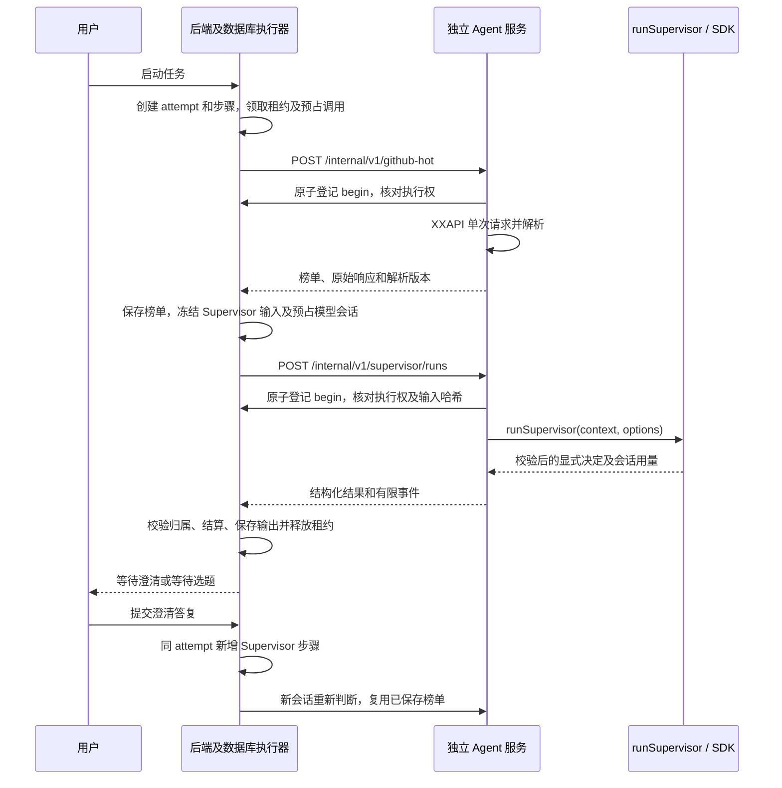

# 后端与独立 Agent 服务

> 2026-11-10 实现更新：后端 → Agent 服务 → Supervisor → 原生 Research 分派、一次性授权消费、网页登记、报告采用及最小页面已接线并完成离线验收。实际 `.env`、业务库和付费调用未动；默认关闭。见[执行链验收及启用方案](../acceptance/d9-backend-agent-pr-2026-11-10.md)。下文未实现描述保留为此前阶段记录。

2026-11-09。当前批次范围由用户确认为：先接通 Supervisor 的真实澄清和等待选题；Research 随后接入。数据库保持既有 `0014` 结构，没有新增或修改迁移。

## 服务边界

后端持有数据库连接、Session、任务状态、配置快照、预算与领取令牌。Agent 服务不导入后端代码或连接业务库，仅通过固定后端 origin 回查执行权，运行 SDK 并返回结果。

创建任务不自动启动执行。任务启动后先获取榜单，Supervisor 再判断要求是否充分；本阶段不能选择项目或分派 Research。页面按服务端执行器配置区分真实/模拟操作，展示 API 候选、澄清问题和 Supervisor 摘要。榜单只包含供应商提供的信息，保留来源顺序，不添加排名或统计周期推断。

## 私有协议及身份

- Agent：`POST /internal/v1/github-hot`、`POST /internal/v1/supervisor/runs`。
- 后端：`POST /internal/v1/agent-runs/check`。
- 共用 `AGENT_SERVICE_TOKEN`，使用 Bearer 请求头及固定长度摘要的恒定时间比较；只允许固定服务 origin，非本机必须 HTTPS；HTTP 跳转显式拒绝。
- 共享契约位于 `shared/src/schemas/agent-service.ts`。模型上下文不含服务凭据、executorId、claimToken 或数据库地址。
- `runId` 使用后端调用记录 ID。执行权检查绑定 task、attempt、generation、领取 token、步骤、输入快照、调用状态及截止时间，同时检查当前任务/租约/取消和发布锁。
- 首次执行前使用 `phase=begin` 在数据库事务中原子登记步骤的派发占用。每步骤只执行一次外部操作；同一 runId 在 Agent 重启后也不能再次领取。Agent 内存中的已用 ID 集合另行拒绝同进程重复请求。
- Supervisor 输入从后端冻结，Agent 计算输入哈希；后端用共享 Schema 规范化冻结 JSON 后核对哈希，避免只核对快照标识而不核对内容。
- Agent 定期回查执行权，客户端断开、服务关闭、失去租约/取消会中止 SDK；后端最终提交再核对执行权。取消先隔离旧代次，迟到结果不能采用。

## 状态与历史

热榜步骤和 Supervisor 步骤均复用 `execution_steps`，用 `runtime_metadata.kind` 区分，不新建第二套任务表。榜单保存在 `github_hot_snapshots`，Supervisor 的输入和决定分别保存在 `frozen_input` / `validated_output`，事件和 SDK 元数据保存在步骤元数据中；完整原始响应不交给前端。

- `needs_clarification` → `awaiting_clarification`。后端为问题生成 ID。答复追加保留；全部待答问题已填写只代表可以重新排队，Supervisor 仍需在新会话判断语义。答复不足时可再次澄清。
- `awaiting_selection` → `awaiting_selection`。保留同一 attempt 和榜单。
- 等待时释放全部租约字段，`active_since/next_run_at/finished_at` 均为空；累计活动时间保留。
- 澄清恢复新增 ordinal，不覆盖旧输入或已完成步骤，不重新抓榜。
- 失败/取消结束 attempt；人工重新执行创建新 attempt，并保留历史及任务累计预算。当前批次发现任务已有项目选择时明确报 `RESEARCH_NOT_ENABLED`，不重新抓榜或假装开展研究。

## 超时、记账与重试

用户已确认：SDK 会话和步骤各 15 分钟、媒体单工具 10 分钟、attempt 累计活动时间 20 分钟、报告格式最多纠正两次。当前只执行 Supervisor，媒体工具尚未装配。`maxOutputAttempts=3` 表示初次输出加两次纠正；格式纠正仍属于同一会话。

一次 `runSupervisor()` 会话计一条模型调用，汇总 SDK 的模型用量后结算一次；本阶段 Research 未启用。热榜单独记一条只读调用，供应商费用标记未知，不虚构成免费。内部事件不再次计模型费用。既有每步骤最多一个 running call 的索引保持不变。

模型调用前按冻结的版本化人民币单价及任务剩余额度预占 Token 和费用；输入/输出单价的最大值用于保守预占，返回后按配置单价结算会话用量，包含缓存输入 Token。该金额是配置口径的估算，不是供应商账单；SDK 美元估算独立保存，不换算成人民币。失败、取消或用量未知保留预占，不清零；费用和调用预算跨人工重试保留。

观测用量达到 Token 预占时会停止后续请求。当前模型响应可能先消耗再被观测，无法宣称这是供应商级的绝对消费硬上限；超出声明上界时后端记录超额并结束尝试。SDK 美元预算也属于 SDK 估算约束。

HTTP、热榜工具及执行器不自动重发；agent attempt 的技术重试次数固定为零。SDK 关闭网络重试和模型/拒绝/非流式回退。失败会记录并交由人工处理，不切换供应商或恢复会话。正常的多轮协调、结构化输出纠正可能包含多次模型请求，不等同于“一次 API 请求”。

## 启用配置

实际本机 `.env` 未由本批自动切换到 agent 模式。启用前需要：

1. 后端和 Agent 使用同一 `AGENT_SERVICE_TOKEN`，为本机生成的 32 字节随机密钥、64 位十六进制编码；不要复用登录密钥。
2. 正确设置 `AGENT_BASE_URL` 与 `BACKEND_INTERNAL_BASE_URL`，默认本机端口分别为 3002 / 3001。
3. Agent 配置官方 `DEEPSEEK_API_KEY`；后端冻结的 `TASK_MODEL_PRICING_VERSION`、输入/输出人民币单价，以及 `AGENT_SESSION_MAX_BUDGET_USD` 必须显式提供。费用口径不能由代码猜测。
4. `TASK_EXECUTOR_MODE=agent`。生产依旧禁止 mock；默认模式不变。
5. 启动两个独立服务后，用户从页面明确启动任务。缺配置时显式拒绝启用，不替换成模拟结果。

## 验证边界

本次允许免费离线检查、一次 DeepSeek 直连接口检查和一次 XXAPI 请求。两次真实请求均已成功且各只发一次：DeepSeek 返回 `OK`，XXAPI 返回 9 个候选及 `title/desc/url` 字段。它们不代表完整 SDK 流程已进行真实付费验收；本批没有再发模型或 XXAPI 请求。

`agent/src/service.test.ts` 使用真实回环 HTTP 和 `runSupervisor()`，仅替换 SDK 传输；`backend/src/agent-client.test.ts` 验证客户端失败不重试及配置约束。`scripts/agent-execution.test.mjs` 在独立临时库和受限角色上验证任务/租约/预算/澄清/取消，SDK 和热榜均注入本地样例。该脚本需显式 `AGENT_TEST_ADMIN_URL`，不读取业务配置、不迁移业务库；退出时清理本次临时库和角色。

离线样例验证控制与持久化，不证明真实模型的语义判断质量。真实 SDK 与 DeepSeek 的结构化工具兼容性尚须单独授权验收；Research、选题授权和视频 Skill 不在本批闭环中。
