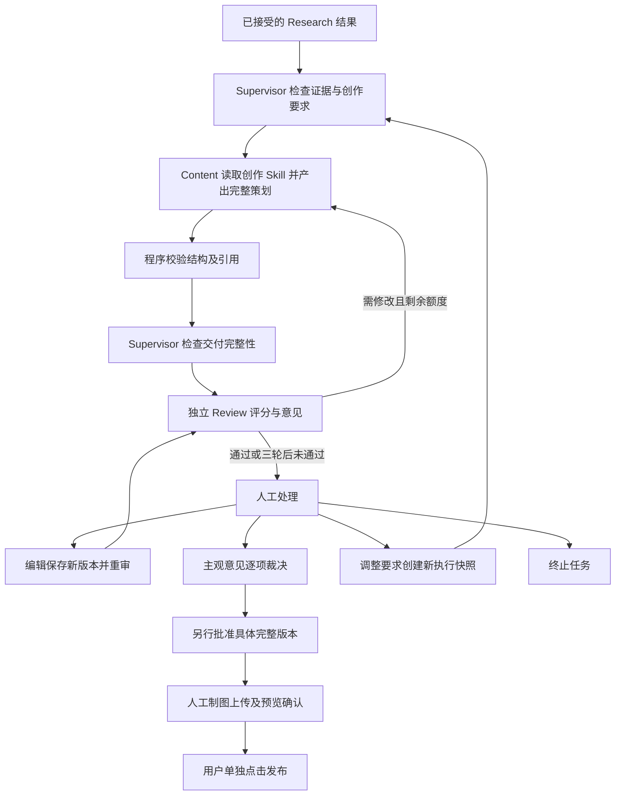

# Content Agent：创作与修订模块

2026-11-07。依据 [PRD V1.1](../product/PRD-V1.1.md) P1-C01—C05。本文区分当前可调用模块与后续业务接入；页面方案见 [内容工作台设计](../design/content-agent-workbench.md)。

## 当前交付与边界

已提供独立 `runContent()`、系统 Prompt、固定版本创作 Skill、只读 MCP 工具、严格输入输出 Schema、交叉引用校验及离线测试。沿用项目的 Claude Agent SDK → DeepSeek 配置，不新增自建模型循环。

2026-11-08 按用户明确提供的百炼密钥来源与北京接口，为 Content 独立入口增加百炼选项，继续使用同一 Agent SDK、Prompt 和工具权限。默认提供商仍为 DeepSeek；其他模型验证入口与 Supervisor 不因此自动切换。

百炼配置使用 `CONTENT_MODEL_PROVIDER=bailian`、`DASHSCOPE_API_KEY`、`BAILIAN_MODEL` 和 `BAILIAN_BASE_URL`，不跨供应商回退密钥。本次模型为 `deepseek-v4.1-flash`，地址由用户提供为 `https://cn-beijing.maas.qianwenaiapi.com/compatible-mode/v1`；已实际确认模型列表返回 200 且包含该模型，同域名的 `/apps/anthropic/v1/messages` 对空请求返回参数校验 400。该域名是本部署的用户指定地址，不将其称为已从公共文档核验的通用域名。

百炼的 Anthropic 兼容接入和该 DeepSeek 模型支持情况，参考 [Messages 接口说明](https://help.aliyun.com/zh/model-studio/anthropic-api-messages) 与 [模型说明](https://help.aliyun.com/zh/model-studio/deepseek-v4-1-flash)。程序仅将允许服务地址上的兼容路径转到同域名的 Anthropic 路径，不扩大网络工具权限；元数据记录真实 provider/baseUrl，避免误报为 DeepSeek 官方服务。

当前人工编辑页补充了每版正文与对应审核、评分来源和“未评分”提示、已有修改轮次编号；未记录轮次时明确显示未知，不以版本号冒充轮次。人工编辑、基础重审、主观裁决、批准与任务终止沿用原服务。

**尚未接通真实任务执行器、Research/Review、完整策划存储及完整策划页面。** 自动三轮调度、持久化人工接管、调整要求新执行和新版完整策划批准属于下文的接入设计，不宣称已经上线。Agent 健康检查仍为 `canExecuteTasks: false`；旧微博业务不自动迁移。本次已验证独立 Content 的真实百炼调用，任务闭环与发布仍未验证。

## 职责与交接



Content 不接收原始热榜并选题，不调搜索或视频工具，不给自己打分，也不把 `draft` 当成通过。Research 的视频证据已经过解析时，Content 仅消费来源摘录和时间定位，不获得 ffmpeg 或视频 Skill 的执行能力。未取得素材时画面建议明确为待制作，不假装已经截图或生成图片。

## 代码位置

| 位置                                           | 用途                                                             |
| ---------------------------------------------- | ---------------------------------------------------------------- |
| `shared/src/schemas/content.ts`                | ContentContext、ContentPlan、ContentOutput 的 Zod 定义及推导类型 |
| `agent/src/agents/content/prompt.ts`           | 角色、职责、输入解释、工具、证据边界、修订及输出要求             |
| `agent/src/agents/content/skill.ts`            | 固定注册表、文件加载、版本与 SHA-256 校验                        |
| `agent/skills/github-project-content/SKILL.md` | 科普角度、逐页表达、制图交付、限定语与修订方法                   |
| `agent/src/agents/content/policy.ts`           | MCP 工具和运行时权限、读取记录、有限输出纠正                     |
| `agent/src/agents/content/validation.ts`       | 项目、来源、事实类型、原文定位及修改回复校验                     |
| `agent/src/agents/content/runtime.ts`          | SDK 入口、超时取消、会话隔离与脱敏元数据                         |
| `agent/src/content-model-config.ts`            | Content 的显式提供商选择、百炼地址与独立凭据隔离                 |
| `agent/src/content.test.ts`                    | 通过真实内存 MCP 调用和注入 SDK 消息进行离线验收                 |

## Prompt 与 Skill 分工

Prompt 固定“我是谁、负责什么、可以调用什么、遇到缺口怎么办、禁止产生哪些业务事实”。Skill 提供“如何把研究写成好懂的科普图文、如何分配页面、怎样保留作者归属及修订意见”。二者不重复维护字段 Schema，唯一字段定义是共享代码。

Skill 随项目保存，没有安装到开发者的全局个人 Skills 目录；这样服务端部署可复现，也不影响其他聊天。`skill.ts` 固定 ID、版本、内容摘要，运行器先校验文件，再把该固定内容挂到只读工具。修改 Skill 时必须同步版本与摘要。摘要按 UTF-8 内容、CRLF 统一为 LF 计算。

不得从任务文本、网页或模型输出选择任意 Skill 路径，也不通过 SDK 自动发现用户目录中的 Skills。缺少注册版本、文件缺失或摘要不符在模型调用前失败。

## 输入、工具调用与输出

可信调用方组装 `ContentContext`，先校验团队/任务/选中项目归属及真实执行权。Context 不是 HTTP 写请求，也不是模型可改写的授权。

| 输入       | 关键字段与语义                                                                       |
| ---------- | ------------------------------------------------------------------------------------ |
| 执行快照   | taskId、attemptId、stepId、inputSnapshotId、epoch；用于落库前再校验                  |
| 项目       | id、selectionId、repository、url；Content 不得改选                                   |
| 当前要求   | revision、objective、audience、tone、constraints、prohibitions                       |
| 格式设置   | pageCount、titleMaxChars、pageBodyMaxChars；未配置为 null，不视为平台规则            |
| 接受的研究 | 研究 ID、项目 ID、sources、facts、gaps、exclusions；只包含实际已核验的索引与摘录     |
| 可用事实   | usableFactIds，由 Supervisor 选定；不能夹带已排除事实                                |
| Skill      | 当前仅 github-project-content / 1.0.0                                                |
| 初稿上下文 | revision.mode=initial，autoRevisionCount=0                                           |
| 修订上下文 | mode=revise，原子预占的 roundId、1—3 轮、父版本完整策划、审核 ID、被审版本及逐条意见 |

来源 locator 可以是正文段落或视频时间段，excerpt 保存必要的真实支持文本。facts.kind 使用 fact / attributed_opinion / inference；后两类必须提供 requiredQualifier，例如“作者介绍”或“基于这些资料推测”。这是一份 Content 专用的 Research 投影，不假装 Research 完整输出契约已实现。

本次唯一业务工具：

```json
{
  "tool": "mcp__content__read_content_skill",
  "input": { "id": "github-project-content", "version": "1.0.0" }
}
```

工具返回 `id/version/sha256/instructions`，不接受 URL、文件路径或命令。最多读取两次；StructuredOutput 的纠正次数由调用方另行限制。运行器核对实际工具 handler 已运行，不能由模型自称“已读 Skill”。研究、父版本、审核意见直接注入，不需要开放通用 Read。工具成功不代表授权发布。

`ContentOutput` 是严格判别联合，拒绝附加的 scores、approved、版本 ID 等字段：

- `draft`：summary、plan、claimRefs、changeResponses、warnings、defaultsUsed。
- `needs_materials`：summary、实际存在的 gapIds、明确的补资料 requests。必须包含全部未解决核心缺口。
- `blocked`：code、summary、requests；用于新发现但尚无研究缺口 ID 的证据不足、研究内部冲突或要求冲突。交回 Supervisor 等待处理，不编造 ID 或自行研究。

`plan` 是完整版本的最小单位，包含 title、cover（headline/subtitle/visualBrief）、pages（key/heading/body/visualBrief）、caption、hashtags、projectUrl、productionNotes。技术上最多 20 页、20 个标签仅用于限制输出资源，不是已经核查的平台限制。Content 不调用生成图像或最终图片审核。

引用与修订回复示例：

```json
{
  "claimRefs": [
    {
      "fieldPath": "pages.overview.body",
      "claim": "作者介绍：支持整理笔记。",
      "kind": "attributed_opinion",
      "factIds": ["fact-1"],
      "sourceIds": ["source-1"]
    }
  ],
  "changeResponses": [
    {
      "issueId": "issue-1",
      "action": "unresolved",
      "fieldPaths": ["title"],
      "reason": "需要人工确认标题偏好。"
    }
  ]
}
```

上述是字段片段，不能直接作为完整模型结果。完整可运行离线样例在 `agent/src/content.test.ts`。fieldPath 采用 `pages.<稳定key>.<字段>`，不依赖页序；拒绝任意对象遍历。引用必须定位原文、属于当前可用事实且保留对应来源与限定语。每个修订意见必须恰好回应一次；`addressed` 是 Content 的自述，是否解决由独立 Review 判断。

程序只能验证引用关系与格式，**不能证明每一句自然语言都已正确引用或与证据语义一致**。遗漏事实映射、歪曲摘录、把禁用说法换一种措辞等，仍需 Review 和人工核实，不能因 Schema 通过直接批准。

## 独立调用

```ts
import { runContent } from './agents/content/index.js';

const result = await runContent(contextBuiltByBackend, {
  signal: stepAbortController.signal,
  limits: {
    timeoutMs: 240_000,
    maxTurns: 8,
    maxBudgetUsd: 0.5,
    maxOutputTokens: 8192,
    maxOutputAttempts: 3,
  },
});
// 再检查真实控制权/epoch/父版本/要求/租约，事务保存完整策划或补材料等待。
```

参数是接入示例，正式资源上限应取现有执行配置，并计入任务预算；SDK 估算费用不是后端账本。没有显式调用不会启动模型，不开放 HTTP 入口，不自动重试整个会话。

运行时保留模型、Prompt/工具策略/Skill 版本及 hash、输入快照、耗时、输出次数、token 用量与 SDK 估算费用；未知费用为 null。事件观察回调失败只累计 observationErrors，不重跑。取消与超时会关闭会话，阻止本次返回候选；跨进程迟到落库仍必须由服务端事务防护。

## 审核、版本和人工操作如何接入

保留现有 ContentVersion、ReviewCycle、ReviewRecord、ManualDecision 的身份及外键关系，为新平台新增版本化策划 payload。完整版本 hash 必须覆盖封面、全部页面、发布正文、项目链接和关键制图说明；不能继续仅对 body 做批准摘要。旧记录按原平台/Schema 读取。

版本序号、自动修改次数与审核次数分别管理。例如：V1 初稿 R0 → 审核失败 → V2 自动修改 R1 → 人工编辑 V3（仍消耗 R1）→ V3 重审。技术重试复用 roundId，重审不新增内容版本，不增加修改次数。轮次由数据库原子预占并关联实际版本；同轮失败可以有限技术重试，不能通过 attempt 更换或重启清零。

Review 应提供审核配置版本、逐项评分及来源、结论、fieldPath、原文片段、依据、问题类型、严重程度和明确建议。现有 scores 没有上限/权重，页面只显示原值和来源，不推算总分。新量表可采用设计文档的权重提案，但上线前须冻结量表版本、分值范围及通过线。确定性/事实问题独立阻断，高分不能抵消。

人工操作的服务端命令设计如下，除已标注现有能力外均需后续实现；不得将这些名称当成已有路由：

| 操作           | 命令数据                                                                      | 事务效果及停止条件                                                               |
| -------------- | ----------------------------------------------------------------------------- | -------------------------------------------------------------------------------- |
| 接管           | expectedRevision、expectedEpoch、reason                                       | controlMode=human，epoch+1，停止活动执行；只返回取消成功不足以确认旧执行失权     |
| 保存           | 现有 baseContentVersionId、expectedRevision，扩展完整 plan                    | 新建不可变人工版本，旧批准/预览确认失效；有运行器时必须先完成接管                |
| 重审           | 现有 contentVersionId、expectedRevision；扩展完整 hash/要求快照               | 只审明确版本；意见与评分不覆盖旧记录，默认不恢复自动修订                         |
| 裁决           | 现有 reviewRecordId、acceptedIssues、unresolvedIssues、reason                 | 逐项记录，仅 subjective 可接受；不改原分数或事实，不代替批准                     |
| 调整要求新执行 | expectedRevision、expectedEpoch、baseRequirementsRevision、完整新要求、reason | 保存要求新快照，epoch+1，失效旧批准；停旧执行后创建新 attempt，保留轮次/累计预算 |
| 恢复自动修订   | expectedRevision、expectedEpoch、parentVersionId、reviewId                    | 显式恢复自动控制并原子预占剩余轮次，满三轮则拒绝自动修订                         |
| 终止           | 现有 expectedRevision、reason                                                 | 沿用任务终止及发布待核实规则，同时使新 Content 执行失权；保留全部历史            |

调整要求后，纯表达改变可复用仍适用的研究；选中项目改变、事实范围扩大或材料不足时先等待人工研究授权，不能因点击“新执行”隐式开展额外研究。审批或发布冻结期间沿用既有锁定规则，不绕过未决发布。

所有写命令必须有会话/团队/角色、CSRF、幂等键和版本校验。候选落库时一次事务同时验证任务未终止、controlMode=automatic、epoch、attempt/租约、要求 revision、研究结果及 parentVersionId。接管与结果同时到达时，只有先持有正确锁并通过全部条件的写入生效；接管返回后旧 epoch 绝不能覆盖人工内容。模型输入里的 epoch 不能代替数据库实时校验。

## 页面展示与完成标准

工作台顶部显示状态、当前版本、Rn/3 和控制权；左侧按版本显示作者、父版本、轮次及产生原因；中间逐页展示标题/文案/画面建议，并对比父版本；右侧仅展示所选版本的审核分数、问题、建议与裁决。历史版本只读，编辑明确另存为新版本。

当前 `ManualEditorial` 只具备纯文本数据；本次已增加对应审核与真实评分字段展示，完整策划布局和新的人工控制按钮必须等服务端接入再开放。没有数值显示“未评分”，没有轮次显示“未记录”，不能用演示数据补齐真实任务。

接入验收至少覆盖：初稿+三轮封顶、同版重审、并发同轮只执行一次、人工接管与落库竞态、旧审核不能批准新版本、核心缺口不能被评分或裁决绕过、调整要求不隐式研究、完整 plan 变更失效批准、取消后迟到结果隔离、发布结果未知时不重新发送。

离线测试覆盖独立模块与真实内存 MCP handler；另外完成了一次百炼模型下的 Skill 读取、完整策划输出及程序校验。持久化轮次与控制权、图文存储、独立 Review 及抖音发布仍须分别联调验收。

## 本次验证记录

2026-11-08 百炼实调成功：用户澄清密钥来自百炼后，按其提供的北京地址连接，确认模型列表 200 和同域名 Anthropic 路径可用。最终使用 `deepseek-v4.1-flash`、Prompt `content-douyin-v2` 和 Skill `github-project-content/1.0.0`，70.5 秒内返回 `draft`，四页内容及引用关系校验通过；真实工具读取事件和 SDK success 均有记录。结果位于 `artifacts/content-invocation-2026-11-08/2026-11-08T09-10-06-868Z-d90ad02d-7dc8-438c-9fdd-1340ec628191.output.json`，同前缀 `.plan.md` 为阅读版。

这次演示的 SDK 估算费用为 0.329014 美元，不是百炼实际账单。原 0.1 美元估算上限曾触发 SDK 中止，演示脚本现为 0.5 美元、四分钟、八轮及三次输出尝试的有限调用。未取消程序校验，也没有生成 Review 分数或批准。四项新增百炼配置测试与 Content 的 17 项测试共 21 项通过。

以下为此前阶段的历史记录，401 的根因随后确认是把百炼凭据用于 DeepSeek 官方接口，而不是已证明密钥本身失效：

2026-11-08 实际调用补充：读取本机配置后，Content 调用两次因超时未取得模型结果；随后在允许联网的环境确认 SDK 可以初始化，但 DeepSeek 官方账号/模型列表接口返回 HTTP 401。当前凭据未通过认证，未产生策划输出、审核、批准或发布。脱敏记录位于 `artifacts/content-invocation-2026-11-08/diagnosis.json`。同时修复断连清理错误覆盖原始超时错误的问题，新增回归测试后 Content 共 16 项离线测试、类型检查与相关 ESLint 检查通过。

- Content 新增 15 项离线测试全部通过，包括实际内存 MCP handler、引用/限定语、修订意见覆盖、输出纠错上限、取消竞态与超时。
- 全项目接口一致性、Prettier、ESLint、TypeScript 和四个包构建通过。修复接口生成脚本的 Windows 分隔符问题，避免把共享类型引用错误展开。
- 共享包 6 项、后端 20 项测试通过。全量检查仍有两项未改动模块的 Windows 兼容性失败：`scripts/setup.test.mjs:50` 直接断言 POSIX 文件权限；`agent/src/memory-config.test.ts:19` 的 `:memory:` 路径拒绝断言在 Windows 下未触发。未扩大本次范围修改这些模块。
- 当时本机没有 Playwright Chromium，未做浏览器验收或真实模型调用；后续独立 Content 实调见上方补充。Skill 的标准 Python 校验脚本因本机缺少 PyYAML 未完成，已人工核对 frontmatter 与使用边界，固定版本与内容摘要由离线测试核对。发布仍未验收。
